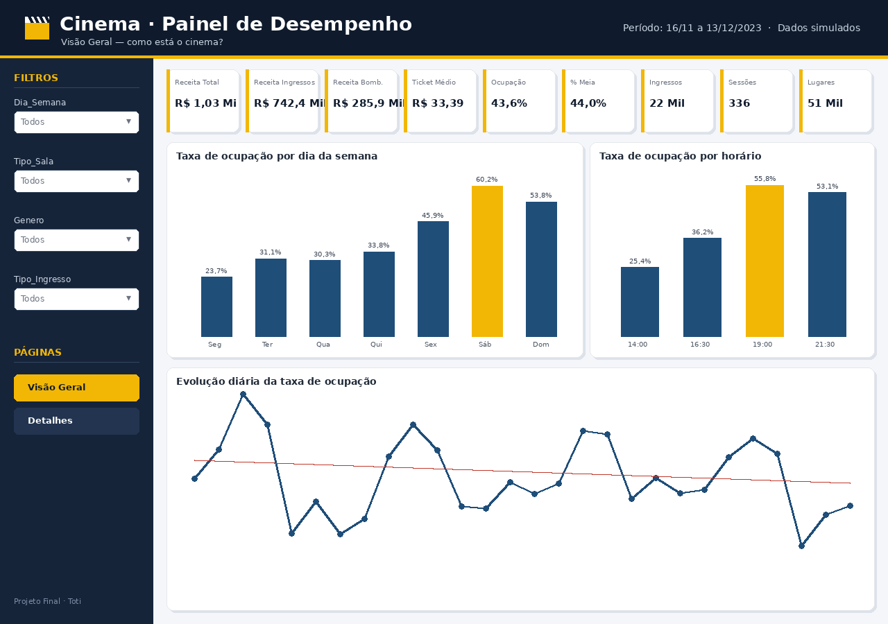
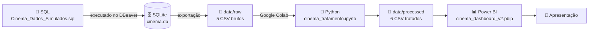
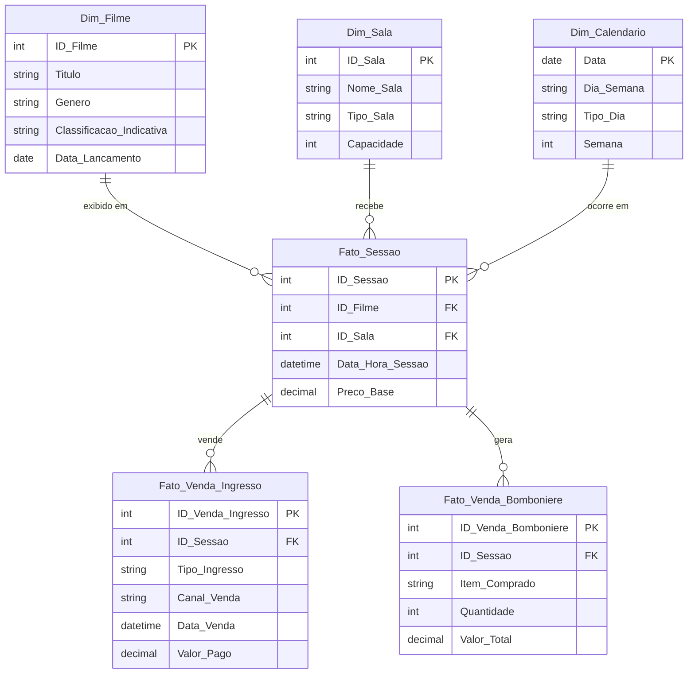

<div align="center">

# 🎬 Cinema · Painel de Desempenho

**Projeto Final de Análise de Dados — Toti Diversidade**

Da base de dados ao dashboard: como está o desempenho de um cinema em ocupação, receita e consumo?


</div>

---

## 📌 Sumário

- [Sobre o projeto](#-sobre-o-projeto)
- [Principais resultados](#-principais-resultados)
- [Insights e recomendações](#-insights-e-recomendações)
- [Pipeline de dados](#-pipeline-de-dados)
- [Modelo de dados](#-modelo-de-dados)
- [Tratamento e validação](#-tratamento-e-validação)
- [Estrutura do repositório](#-estrutura-do-repositório)
- [Como reproduzir](#-como-reproduzir)
- [Uso de Inteligência Artificial](#-uso-de-inteligência-artificial)
- [Limitações](#-limitações)
- [Fluxo de trabalho do grupo](#-fluxo-de-trabalho-do-grupo)
- [Equipe](#-equipe)

---

## 🎯 Sobre o projeto

O projeto analisa a operação de um cinema fictício durante **28 dias** (16/11/2023 a 13/12/2023), cobrindo **sessões, venda de ingressos e vendas da bomboniere**.

**Pergunta de negócio:** *como está o cinema?* Ou seja: quanto da capacidade é ocupada, quando o público aparece, quanto se fatura e onde estão as oportunidades.

O trabalho percorre todas as etapas de um projeto de dados:

| Etapa | Ferramenta | Entrega |
|---|---|---|
| 1. Modelagem e carga | SQL (SQLite + DBeaver) | Banco dimensional com 5 tabelas |
| 2. Exportação | DBeaver | 5 arquivos CSV brutos |
| 3. Tratamento e validação | Python (Google Colab) | 6 arquivos CSV tratados |
| 4. Visualização | Power BI | Dashboard com 3 páginas |
| 5. Comunicação | Apresentação | Insights e recomendações |

> ⚠️ **Os dados são simulados.** Não representam um cinema real. Os padrões observados vêm das regras usadas na simulação, e as recomendações são um exercício de análise.

<div align="center">



*Mockup da página "Visão Geral" do painel.*

</div>

---

## 📊 Principais resultados

Valores conferidos em **SQL, Python, Excel e Power BI**: os quatro chegam aos mesmos números.

| Indicador | Valor |
|---|---:|
| Sessões realizadas | **336** |
| Lugares ofertados | **50.940** |
| Ingressos vendidos | **22.235** |
| **Taxa de ocupação** | **43,6%** |
| Receita total | **R$ 1.028.261,50** |
| Receita de ingressos | R$ 742.397,50 |
| Receita da bomboniere | R$ 285.864,00 (27,8% do total) |
| Ticket médio do ingresso | **R$ 33,39** |
| Bomboniere por ingresso vendido | R$ 12,86 |
| Participação da meia-entrada | 44,0% |

> **Em uma frase:** de cada 10 lugares oferecidos, cerca de 4 foram ocupados.

---

## 💡 Insights e recomendações

### Quando o público aparece

| Fato (verificado) | Interpretação |
|---|---|
| Sábado **60,2%** e domingo **53,8%** de ocupação | O fim de semana concentra o público |
| Segunda-feira **23,7%** | Na segunda, cerca de 3/4 da sala fica vazia |
| Terça a quinta entre **30% e 34%** | Meio de semana estável, porém baixo |
| Sábado ≈ **2,5 ×** segunda | Há muita capacidade ociosa em dias úteis |
| Sessões das **19:00 (55,8%)** e **21:30 (53,1%)** | A noite concentra o público |
| Sessão das **14:00 (25,4%)** | A tarde é a maior capacidade ociosa |

**Pior cenário:** segunda-feira às 14:00. **Melhor cenário:** sábado à noite.

### Salas, gêneros e canais

| Fato (verificado) | Interpretação |
|---|---|
| Salas **VIP** têm a maior ocupação (**50,5%**) e a menor meia-entrada (**31,5%**, contra ~45% nas demais) | Público VIP paga mais e lota mais |
| **Terror** tem a maior ocupação por gênero (**57,7%**), mas com apenas 13 sessões | Sinal interessante, porém com amostra pequena |
| **Site** responde por **39%** dos ingressos; canais digitais somam **66,7%** | O público compra principalmente online |
| Compra digital: ~**32 h** de antecedência; presencial: ~**1,5 h** | Quem compra online planeja; quem vai à bilheteria decide na hora |
| **Combos** geram **48%** da receita da bomboniere | Combo é o principal produto da bomboniere |

### Recomendações (exercício de análise)

1. **Promoções de segunda a quinta**, por exemplo "segunda a preço único", para levar público aos dias vazios.
2. **Preço reduzido ou combo com bomboniere nas sessões das 14:00** em dias úteis.
3. **Comunicação nos canais digitais**, que concentram a maior parte das vendas antecipadas.

---

## 🔄 Pipeline de dados



---

## 🗂️ Modelo de dados

O banco segue um **modelo dimensional**: tabelas de **dimensão** (o contexto: filme, sala, data) e tabelas de **fato** (os eventos: sessões e vendas).



| Tabela | Tipo | Linhas | Descrição |
|---|---|---:|---|
| `Dim_Filme` | Dimensão | 20 | Filmes em cartaz |
| `Dim_Sala` | Dimensão | 20 | Salas (Padrão, 3D XPLUS, VIP, IMAX) e capacidade |
| `Dim_Calendario` | Dimensão | 28 | Um dia por linha; criada no Python |
| `Fato_Sessao` | Fato | 336 | Cada sessão: filme × sala × data/hora |
| `Fato_Venda_Ingresso` | Fato | 22.235 | Um ingresso por linha |
| `Fato_Venda_Bomboniere` | Fato | 7.454 | Uma venda da bomboniere por linha |

---

## 🧹 Tratamento e validação

O notebook [`notebooks/cinema_tratamento.ipynb`](notebooks/cinema_tratamento.ipynb) documenta cada passo.

**Bibliotecas:** `pandas` (tabelas) e `numpy` (cálculos e condições).

| Etapa | O que foi feito |
|---|---|
| Diagnóstico | Contagem de nulos, duplicados e tipos de cada coluna: **0 nulos e 0 duplicados** |
| Tipos | Textos convertidos em data/hora; valores em dinheiro como decimal |
| Padronização | Remoção de espaços extras nos textos |
| Chaves | Garantia de que nenhuma chave primária se repete |
| Enriquecimento | `Hora`, `Faixa_Horaria`, `Dias_Em_Cartaz`, `Fase_Lancamento`, `Antecedencia_Horas`, `Faixa_Antecedencia`, `Tipo_Canal`, `Preco_Unitario`, `Categoria_Item` |
| Calendário | Criação da `Dim_Calendario` (28 dias) |
| Exportação | 6 CSV tratados em `data/processed/` |

### 10 regras de negócio validadas — todas com **0 registros com problema**

- Sessões com filme ou sala inexistente
- Ingressos ou vendas de bomboniere de sessão inexistente
- Sessões com mais ingressos que a capacidade da sala
- Ingressos com valor diferente da regra inteira/meia (meia = 50%)
- Ingressos vendidos depois do início da sessão
- Sessões antes da data de lançamento do filme
- Duas sessões na mesma sala e no mesmo horário
- Vendas de bomboniere com quantidade ou valor menor ou igual a zero

A conferência cruzada entre SQL, Python, Excel e Power BI está em [`docs/05_cinema_validacao_cruzada.xlsx`](docs/05_cinema_validacao_cruzada.xlsx).

---

## 📁 Estrutura do repositório

```
projeto-final-cinema/
├── data/
│   ├── cinema.db                 # Banco SQLite com as 5 tabelas
│   ├── raw/                      # 5 CSV exportados do banco (sem tratamento)
│   └── processed/                # 6 CSV tratados no Python (usados no Power BI)
├── sql/
│   ├── Database_Cinema.sql       # Primeira versão: estrutura + amostra de 25 registros
│   └── Cinema_Dados_Simulados.sql# Versão final: gera exatamente o cinema.db
├── notebooks/
│   └── cinema_tratamento.ipynb   # Tratamento, validação e análise exploratória
├── powerbi/
│   ├── cinema_dashboard_v2.pbip  # Abre o dashboard no Power BI Desktop
│   ├── cinema_dashboard_v2.Report/
│   ├── cinema_dashboard_v2.SemanticModel/
│   └── entrega/                  # Versão .pbix para entrega, se solicitada
├── docs/
│   ├── 05_cinema_validacao_cruzada.xlsx
│   ├── insights.txt
│   └── img/                      # Mockups, fundos e tema de cores do painel
├── apresentacao/                 # Slides finais
└── scripts/                      # Scripts auxiliares
```

---

## ▶️ Como reproduzir

### 1. Clonar o repositório

> **Importante:** clone diretamente em `C:\`. O dashboard lê os dados de `C:\projeto-final-cinema\data\processed\`.

```bash
cd /c/
git clone https://github.com/ncarrillo79/projeto-final-cinema.git
```

### 2. Banco de dados (opcional)

- **Ver os dados:** no DBeaver, crie uma conexão **SQLite** e aponte para `data/cinema.db`.
- **Recriar o banco do zero:** crie uma conexão SQLite nova, abra `sql/Cinema_Dados_Simulados.sql` e execute com **Alt + X**.

### 3. Tratamento em Python (opcional)

Coloque os 5 CSV de `data/raw/` em `Meu Drive/projetoCinema/` no Google Drive e execute o notebook no Colab com **Ambiente de execução › Executar tudo**.

### 4. Dashboard

1. No Power BI Desktop, ative **Arquivo › Opções › Recursos de visualização › Salvar como Projeto do Power BI (.pbip)** e reinicie o programa.
2. Abra `powerbi/cinema_dashboard_v2.pbip`.
3. Clique em **Página Inicial › Atualizar**.

---

## 🤖 Uso de Inteligência Artificial

O uso de IA foi permitido no projeto, desde que explicado. Registramos com transparência:

- **Apoio ao desenvolvimento:** a IA também foi usada como apoio para explicar conceitos e revisar o código. As decisões de análise e a validação dos resultados foram feitas pelo grupo.

---

## ⚠️ Limitações

- **Dados simulados:** os padrões refletem as regras da simulação, não um cinema real.
- **Período curto:** 28 dias não permitem analisar sazonalidade.
- **Bomboniere sempre ligada a uma sessão:** na vida real, nem toda compra na bomboniere está ligada a um ingresso.
- **Amostras pequenas em alguns recortes:** por exemplo, Terror (13 sessões) e Suspense (7 sessões).

---

## 🤝 Fluxo de trabalho do grupo

A branch `main` é protegida: **ninguém altera a `main` diretamente**.

1. Atualize sua cópia: `git pull`
2. Crie uma branch: `git checkout -b tipo/descricao-curta` (ex.: `powerbi/pagina-bomboniere`)
3. Faça os commits e envie: `git push -u origin tipo/descricao-curta`
4. Abra um **Pull Request** no GitHub.
5. A responsável pelo repositório revisa e aprova o merge.

**Regra do Power BI:** só uma pessoa edita o dashboard por vez. Avise o grupo antes de abrir o arquivo.

---

## 👥 Equipe

| Integrante | Papel |
|---|---|
| Norma Fajardo | Responsável pelo repositório - Dashboard Power BI |
| Eugenio Matheus | Colaborador do repositório - Criação banco de dados e inserir dados simulados|
| Marcelino Issa |Colaborador do repositório - Python Importar e tratar dados GoogleColab |
<!-- Adicione aqui os demais integrantes do grupo, uma linha por pessoa:
| Nome Sobrenome | Papel |
-->

---

<div align="center">

Projeto acadêmico — **Toti Diversidade** · Dados simulados para fins educacionais

</div>
